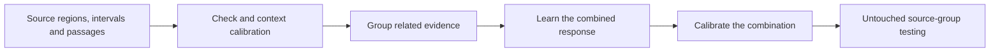

# Scoped specialist calibration across images, video, audio and passages

The local evaluation framework now supports separate calibrations for distinct
checks and contexts, followed by a separately fitted and calibrated combination.
This implements the cross-modal testing architecture requested7 November2026.
It does not establish improved real-media detection, supply new trained detectors
or change customer confidence. Every generated artifact has `serving_admitted:false`.

The current recipe is **version2**. The first authored prototype passed local and
Linux numerical checks, but four later semantic regression tests exposed negative
evidence from an unrelated region subtracting from positive evidence elsewhere.
Version2 fixes that any-AI pooling rule before real-data fitting. The old numerical
result, failed launch and four failing tests are preserved; no serving score was
ever changed by either prototype.

## Scope of the next real-data comparisons

| Medium | Specialist evidence | Conditions selected before detection scores | Controls that must remain genuine |
| --- | --- | --- | --- |
| Image | Face regions, other edit regions, whole-image generation | Face visibility, texture, resolution, compression | Ordinary texture/edges, camera processing and non-AI edits |
| Video | Face-swap tracks, mouth/lip-sync intervals, general synthetic clips | Face/mouth visibility, speech presence, scene transitions, codec/frame rate | Real cuts, lighting changes, correctly synchronized speech and compression |
| Audio/voice | Source-bound voice windows; future separately validated background-manipulation checks | Measured speech/noise/music/overlap conditions | Real noisy voices, music, room changes, overlap and microphone artifacts |
| Passage | Exact passages with explicit local authorship truth | Length, extraction quality, language, prose/email/quotation structure | Human writing, quotations, editing and mixed human/AI documents |

Scene cuts and background noise are conditions and alternative explanations.
Their presence alone is not AI evidence. A sound-event classifier does not prove
synthetic background audio. Mixed human/AI status is a truth/evaluation stratum,
not a routing feature available before detection. No new context specialist may
contribute until its own target, labels, model license and detection value are
verified. Existing local image/audio/video/writing baselines and rollback remain.

## Local truth and source coordinates

`backend/app/bench/specialists.py` is research-only. It accepts explicitly planned
observations, not uploads or arbitrary unscoped probabilities. Each observation
binds a specialist, declared target, dependency family, score-blind context rule,
measurement commitment, status and source coordinates:

- Images: stored-source integer pixel rectangle and original dimensions.
- Video: integer source nanosecond interval, file duration and original PTS-table
  commitment. Supplied frame ranges and pixel regions are checked against the
  file's declared frame count/dimensions. The adapter must still verify the actual
  time/frame/PTS correspondence.
- Audio: original sample interval/extent/rate, agreeing with the file's clock.
- Passages: Unicode-codepoint offsets and extracted-text extent/digest, matching
  the file's extracted-text identity. Byte offsets cannot be substituted.

Each known local label needs its own source/provenance digest and `local_unit`
scope. A whole-file AI label cannot fill unknown local labels. A positive file
can contain genuine regions/passages, and complete local labels must agree with
the declared union truth for the planned scope. The combined target is any
supported AI evidence **within the planned units**, not authenticity of unseen
parts of an upload. Metadata validation cannot independently verify the supplied
truth, media decoding, routing implementation or license grant; source/native
audits are still required.

Model observations must declare exact implementation/weight hashes, a commercial
license-review record and a native-inference receipt. Authored synthetic fixtures
have a separate producer kind and are never presented as real-model evidence.
Routing rules and profile measurements are frozen before detection scores;
selecting a calibration from the suspicious score or known truth is prohibited.

## Four disjoint roles

1. **Specialist calibration:** fit a monotone response mapping separately for each
   check/context, using verified local labels. Balance observations by connected
   source and truth class. Smooth targets using independent source counts, not
   thousands of correlated frames. The default minimum is25 distinct source
   groups per class and context; this is a support floor, not an accuracy guarantee.
2. **Combination fitting:** on different source groups, learn nonnegative weights
   from the specialist outputs. Within one dependency family use its maximum
   **positive** calibrated logit, floored at zero, so duplicate windows do not add
   independent votes and a genuine region cannot subtract from a positive region
   in this any-AI scope. Local genuine-leaning estimates remain inspectable. This is
   a feature of a supervised combiner, not an independent-probability product.
3. **Combination calibration:** on another source-disjoint set, calibrate the
   combined response. Separately calibrated inputs do not automatically make a
   calibrated combined score.
4. **Confirmation:** evaluate the frozen pipeline on untouched groups. Confirmation
   responses cannot change any specialist, combiner or calibration parameter.

Source IDs, exact original/input hashes and declared connected lineage cannot
cross these roles, including across modalities. Author/speaker/actor/background
and prompt relationships must be audited by the real-data adapter. The framework
does not discover undeclared relationships. Cross-fitting can be a future,
separately reviewed alternative when data is scarce; do not quietly reuse roles.

These four roles assume the base detector is already fixed. Exclude all known
project-level base-detector/head training ancestry from them, or fit that head on
a separate earlier source-disjoint set. Cached scores from a head trained on the
new calibration/confirmation sources are not out-of-sample observations. The
source adapters must audit that provenance before real fitting. External
pretraining overlap may remain unknown and must be disclosed. Benchmark-only
generator identities or true mixture SNR cannot substitute for routing features
measured on an unknown customer input.



Sparse contexts receive `insufficient_support`, with no fabricated probability
or implicit pooled fallback. Missing, skipped and failed required observations
withhold a combined score. Local available outputs remain inspectable with their
own positions. No missing check becomes evidence of originality. A separately
validated fallback could be added prospectively; it must identify its scope.

## Meaning and limits of numerical outputs

The prototype uses a declared50:50 reference prior. Its probabilities are research
estimates for that reference distribution and planned scope, not the chance a
customer's file is fake or the probability that an examiner is correct. Outputs
have no public screening cutoff. Confirmation summaries include every planned
file, scored/inconclusive counts and source-balanced Brier loss on scored cases.
The scored-case metric is not an all-case accuracy measure. Real adoption tests
must additionally freeze operational comparisons, false alarms, missed AI,
inconclusive/coverage rates, localization quality and uncertainty per context.

Category-dependent calibration has precedents, including
[Mondrian conformal regressors](https://proceedings.mlr.press/v128/bostrom20a.html).
Our image/video/audio/text design is an engineering proposal, not a demonstrated
application of that paper's regression guarantees. The distinction between raw
network confidence and measured calibration is discussed by
[Guo et al.](https://proceedings.mlr.press/v70/guo17a.html).
Calibration cannot supply discrimination absent from a detector. The completed
[v8](image-patch-drift-v8-development-evaluation.md) and
[v9](image-region-calibration-v9-result.md) image failures remain failures.

## Local command interface

Prepare a private JSON manifest with schema `chipmunk.specialist-evaluation/2`,
`policy.specialists`, source geometry and complete `files`/`units` arrays. The authored fixture in
`backend/tests/test_specialist_calibration.py` is an executable structural example,
not a real dataset or example of native model output. A
[public authored manifest](evaluation-panels/specialist-calibration-v2-authored-manifest.json)
and its [recorded numerical outputs](evaluation-panels/specialist-calibration-v2-authored-expected.json)
are available for a lean numerical reproduction with NumPy2.2.6/SciPy1.18.1 only.
Its source, routing, measurement and label-provenance hashes identify authored
symbolic placeholders; they do not claim nonexistent real-media files or native
inference. The separate release/code/packet hashes verify actual published bytes.

```sh
PYTHONPATH=backend python -m scripts.specialist_calibration audit manifest.json audit.json
PYTHONPATH=backend python -m scripts.specialist_calibration freeze manifest.json freeze.json
PYTHONPATH=backend python -m scripts.specialist_calibration fit manifest.json fitted.json --frozen freeze.json
PYTHONPATH=backend python -m scripts.specialist_calibration evaluate manifest.json confirmation.json --artifact fitted.json
```

Freeze commits to the plan, all fitting/calibration observations, code, numerical
runtime and options. Future confirmation responses may be filled without changing
the source/label/context/coordinate plan. All outputs refuse overwrite. The
library fits no raw-media model, starts no API worker and creates no payment.
Nothing in the serving engine imports or admits this research module.

## Evidence completed and still required

The authored synthetic CLI run covers128 files/512 observations across all four
modalities,16 check/context calibrators, four combiners with their own calibration,
32 confirmation files and128 local confirmation outputs. Its deliberately small
support setting is3, solely for integration testing. The25-group default correctly
withholds scores on that fixture. Sixty-three selected tests pass, including
existing independent-evaluation checks, role leakage, wrong coordinate units,
copied whole-file labels, missing evidence, duplicate-family votes, confirmation
isolation, model-review commitments, source-geometry binding, unrelated-negative
evidence and freeze integrity.

The separate-host authored smoke has a prospectively fixed absolute probability
agreement limit of1e-6 over32 file and128 unit outputs, exact nonnumerical
bindings, and six adverse invariants. Its numerical tolerance applies only to
this new authored integration test, not earlier studies' exact-fit requirements.
The workflow needs no model, image/audio/video processing, API or customer data.
The [actual corrected Linux run](https://github.com/ChipmunkRPA/veritas/actions/runs/42395499155)
passed all six invariants and compared160 file/unit probabilities. Its maximum
absolute difference from the recorded Mac outputs was5.551115123125783e-17,
within the unchanged1e-6 limit. The
[decoded-log receipt](evaluation-panels/specialist-calibration-v2-linux-review.json)
records the actual job. This establishes authored numerical integration only.

Still required across **all four modalities**: inventory actual local-unit truth
and independent groups; build audited source/context adapters; obtain missing
per-context support; freeze and run specialist/combined comparisons against the
current system; perform fresh confirmation and outside human review; then verify
paid UI/API/PDF/JSON evidence and generic public names before any local admission.
Do not equate the completed harness with completed calibration or improved
detection. Public methods/limitations and educational resources can be shared;
customer uploads, real face embeddings and raw research media remain private.
Outreach still requires its existing authorization. GCP remains last.

## First real-data adapter: passages

The [v5 passage pilot](writing-specialists-v5-result.md) now fits and tests four
arms using real retained responses on128 prompt components and exact copied
source passages. Separate length calibration plus two fixed detectors improved
file Brier loss and reduced human false alarms, but increased missed AI at the
frozen diagnostic readout. It is not serving-admitted. Prompt/duplicate isolation
does not establish independence between writers, and external training overlap
is unknown. This is a real-data development step, distinct from the authored
v2 harness. Broader independent-source confirmation remains required.

The [v10 image pilot](image-specialists-v10-result.md) now tests whole-image and
source-bound quadrant calibrations with separate PNG/JPEG contexts on240 consumed
source pairs. Regional readouts found more edits at a higher false-alarm rate;
JPEG remained weak. It is not serving-admitted. All960 input hashes and4,800
local-truth boxes were independently reconstructed; all144 retained native maps
matched. Video and noisy-voice adapters remain, and neither pilot completes the
four-media rollout or establishes general customer accuracy.
