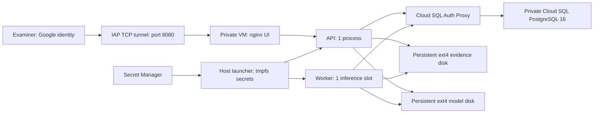

# Veritas on Google Cloud — private single-host deployment

This bundle prepares a **private, single-VM deployment with separate API and worker processes**, a managed PostgreSQL database,
and durable POSIX evidence/model storage. It has **not been deployed**. The [readiness record](../../docs/GOAL_READINESS.md)
identifies the exact source and limits of local checks: Terraform schema/mock plans, deployment contracts, emulated Linux
CPU/frontend packaging, local PostgreSQL/API/worker startup and restart, and bounded image inference/reporting. Current-source
native Darwin CPU image execution is separately verified. Cloud SQL IAM/TLS, native Linux/CUDA inference, performance,
systemd/reboot and coordinated restoration remain staging gates before serving casework. Independent detection quality and
full text/video execution in the deployment images remain open.

## Architecture and boundaries



Cloud Run's ephemeral filesystem does not satisfy this application's current shared-path contract. Evidence objects, uploaded
working copies, stage outputs, reports and signing keys live under `/data`; pinned model caches live under `/models`. Moving API
and worker to independently scaled services requires a storage redesign or a tested shared POSIX service. Cloud Storage FUSE is
not treated as an equivalent filesystem in this bundle.

| Component | Configured behavior |
|---|---|
| Host | One `n2-standard-16` CPU VM (16 vCPU, 64 GB RAM), no public IP; optional `g2-standard-16` with one NVIDIA L4 |
| API / worker | Separate containers; one API process, `RUN_WORKER=false`, worker threads `1`; worker waits for API and database readiness, and web waits for both API and worker health. Docker retries nonzero process exits; systemd owns stack startup after VM/Docker restarts. |
| Network | Only IAP source range reaches TCP 22/8080. API/worker/preflight share an internal Docker network. Nginx has a separate ingress network for its published port; SQL proxies have a routed control network. Host NAT enables package/image provisioning. |
| Identity | Google IAM gates the tunnel; Veritas password sessions, named principals and case RBAC remain required. IAP identity is **not** automatically mapped to a Veritas principal. |
| Database | Regional Cloud SQL PostgreSQL 16, private IP only, IAM authentication through proxy; runtime role owns no table. Owner migrations are separate. |
| Storage | 500 GB evidence disk and 300 GB model disk by default; ext4, explicit device identity, persistent across VM replacement; protected from Terraform destruction |
| Secrets | Secret Manager stores `api_key` and independent `signing_key`; pinned numeric version fetched into `/run` tmpfs; no values in Terraform, startup metadata or Compose JSON |
| Models | Explicit `commercial` licence policy, `full` profile, offline serving, no runtime downloads; manager budgets 24,576 MiB CPU / 20,000 MiB GPU for weights and estimated activations. These accounting budgets do not prove physical capacity. The worker container limit is 48 GiB. |
| Durability | Cloud SQL automated backups + 7-day PITR; daily disk snapshots retained 14 days; these do **not** form a coordinated recovery point |
| Scaling | Fixed one VM, API, worker and inference slot. No autoscaler. CPU/memory limits leave capacity for host, proxy, nginx and decoding. |

The GPU variant uses the repository's CUDA 12.6 backend image and a pinned Ubuntu 24.04 host image with a compatible NVIDIA driver
(at least 560). Startup checks `nvidia-smi`, installs the NVIDIA Container Toolkit and configures Docker. Only the worker reserves
a GPU. The worker refuses startup if CUDA is unavailable. Host maintenance terminates/restarts GPU VMs; queued jobs recover via
leases. These hardware checks are configured, not yet observed on GCP. CPU inference latency has not been measured on this VM.

The generated `config.json` requires actual JSON booleans for `gpu_enabled` and `runtime_enabled`: use `true` or `false`,
without quotes. Missing flags, strings (including `"false"`), numbers and null are refused before credentials, image pulls or
new service starts. For `start` and `admin-proxy`, the existing ordered cleanup of this Compose project still occurs before
configuration validation. Terraform emits correctly typed flags; its valid CPU/GPU configurations are unchanged.

## Local checks (no credentials or deployment)

Run from the repository root. Terraform initialization downloads only the signed provider plugin; it does not contact a project.
Terraform 1.9+ is required for cross-variable validation. Commit `.terraform.lock.hcl`.

```sh
terraform -chdir=infra/gcp init -backend=false
terraform -chdir=infra/gcp fmt -check -recursive
terraform -chdir=infra/gcp validate
terraform -chdir=infra/gcp test
cd backend
PYTHONDONTWRITEBYTECODE=1 OMP_NUM_THREADS=1 OPENBLAS_NUM_THREADS=1 .venv/bin/python -m pytest -p no:cacheprovider ../infra/gcp/tests tests/test_deployment.py
.venv/bin/ruff check --no-cache --config ../infra/gcp/pyproject.toml ../infra/gcp
```

The pytest line runs every test file under `infra/gcp/tests` (six files) and the deployment tests of the backend. `make ci-release`
runs `terraform test` and the six files as two of its steps, with the Postgres suite and the audit of the runtime locks
(`docs/runbook.md`, "Release gate").

`terraform test` uses a mock Google provider. It checks private CPU/GPU plans, exact named boot-image propagation, and rejection
of boot-image families/aliases and query/fragment suffixes, unpinned container images, a GPU without a CUDA
image, and a zone outside the region. Runtime tests run `docker compose config` only, without a daemon. Do not treat these as a live
cloud plan, image build or application smoke test.

## Isolated runtime smoke contract

`backend/scripts/image_smoke.py` runs seven bounded checks in disposable subprocesses: isolated configuration, ffmpeg/ffprobe and
ExifTool (at least 12.24), OpenCV/psycopg imports, the pinned Python dependency contract, CLI help plus a commercial/full **dry-run**, migrations to head and repeat-at-head
on temporary SQLite, and one synthetic summary PDF through the real report renderer. The PDF check verifies expected text and
embedded bundled fonts. No server starts, models are never fetched or loaded, and no live database or cloud service is contacted.
The children discard inherited application settings and credentials, disable dotenv/secret-file loading before app imports,
block network connections, and use temporary data, model and cache directories. Each child has a 60-second timeout; temporary
files are removed on normal completion, including check failures. JSON stdout records platform, UID/GID and individual failures;
any failed check returns nonzero. Synthetic development settings do not exercise production authentication or startup.

The dependency check uses the image’s build-written CPU/cu126 marker, verifies all installed package versions and `pip check`,
then checks the compiled CUDA identity and a tiny torchvision CPU operation. A GPU is not required for this native-operation
check; it does not exercise CUDA inference. Linux refuses a missing/invalid backend marker. The build uses hash-locked
[Python dependencies](../../backend/requirements/README.md), with dependency resolution disabled for the later project install.

A local harness check that does not use Docker:

```sh
backend/.venv/bin/python -B backend/scripts/image_smoke.py > backend/data/image-smoke-local.json
```

A Darwin result validates only local dependencies and harness behavior. The last images built for `linux/amd64` and run against this contract are those of the release commit `a876a43a` (11 October 2026): the CPU backend image, built with its base pinned by digest, passed this contract in the image, seven of seven checks, with `--user 10001:10001` and without it, and the web image built with its revision label ([check 50 of the supervisor's checks](../../docs/v2/qa/prod-readiness-2026-09-29/supervisor-checks.md)). Before them the images of commit `ff6c310` passed it (check 10 of the same record), and the images of commit `5f0cb16` were built on the review machine and run as a stack (check 13), not against this contract. The backend image ran under emulation on an Apple host, not on a native `amd64` host; the CUDA variant has never been built, and no image was scanned. Earlier, the `12f3915` CPU image passed all seven checks under Linux amd64 emulation and the matching frontend passed Nginx and nine internal HTTP checks. [CPU receipt](../../docs/v2/qa/linux-image-inference-2026-09-19/cpu-builds/12f39156b7dc-r14/cpu-result.json) and [frontend receipt](../../docs/v2/qa/linux-image-inference-2026-09-19/frontend-builds/12f39156b7dc-r14/frontend-result.json) record immutable image IDs and scope. Run this contract for each reviewed CPU/CUDA backend image, retaining JSON beside its immutable image digest:

```sh
smoke_image='<reviewed-backend-image>@sha256:<digest>'
docker run --rm --network none --read-only --user 10001:10001 \
  --tmpfs /tmp:rw,nosuid,nodev,mode=1777,size=256m --entrypoint python \
  "$smoke_image" /srv/scripts/image_smoke.py --require-image-runtime > image-smoke.json
```

The image flag requires Linux amd64 and UID/GID 10001; it cannot establish image provenance by itself. This command mounts no
application data, model caches or credentials. SQLite migration success does **not** validate PostgreSQL/Cloud SQL migrations,
grants or IAM. Production startup, populated cloud-volume permissions, model/GPU compatibility, inference and end-to-end signed
reports remain separate release gates. No image build or container execution is implied by adding or locally testing this script.

## Release preparation and controlled provisioning

The following steps are an operator runbook for a **separately authorized future deployment**. No cloud step has been executed. Local CPU/frontend image and production-mode fixture checks are recorded separately. **No local stage is bound to the commit of 2.1.1 or to any commit after `e3f0ba6`.** The last one made is `backend/data/releases/2026-09-19-face-scope-e3f0ba6/`, bound to application revision `e3f0ba633e5a39969d7004480f46bf26ac44a745` ([staging receipt](../../docs/v2/qa/face-finding-scope-2026-09-19/local-release.json), six file hashes and the manifest); the stage before it, `2026-09-19-cache-173102d/`, and the earlier ones are in the historical sections below. A stage is bound to one commit: the startup preflight refuses a manifest whose `build_commit` is not the image's, so the commit that is released needs a stage of its own (step 4), made from that checkout. Local emulation does not certify cloud deployment.
Use a dedicated project, review cost/quota/region/data residency, and keep infrastructure state in an access-controlled, versioned
remote backend before applying. This module intentionally does not create a backend bucket or read application secrets in Terraform.

1. **Build and review the release on a connected Linux amd64 builder.** Build the backend with `backend/Dockerfile`, `VARIANT=cpu`,
   and `VERITAS_BUILD_COMMIT=<full commit>`; build `frontend/Dockerfile` from the same checkout with the same build argument. For GPU, also build `VARIANT=cuda`.
   The backend installs the `postgres` extra. Run dependency scanning and image smoke tests (ffmpeg, ExifTool, Pango, `import psycopg`,
   API startup, report rendering) there. Use the published manifest digest, not a tag. Mirror a reviewed **Cloud SQL Auth Proxy v2**
   image to the same Artifact Registry repository. Set `boot_image` to `projects/PROJECT/global/images/IMAGE` or its
   `https://www.googleapis.com/compute/v1/` self-link. Terraform rejects moving image families, abbreviated aliases, queries and
   fragments. The named reference must identify the reviewed Ubuntu 24.04 amd64 image (and reviewed NVIDIA driver for GPU).
   Syntax validation does not prove that the image exists, has the required contents, or has not been deleted and recreated;
   retain its numeric image ID and review evidence with the release. Runtime host packages are installed from signed repositories, so record their installed versions in staging;
   fully repeatable host builds require a baked, patched image pipeline.

   On that future authorized builder, pass the same full source revision to both image builds:

   ```sh
   release_commit=$(git rev-parse HEAD)
   docker build --platform linux/amd64 --build-arg VARIANT=cpu --build-arg VERITAS_BUILD_COMMIT="$release_commit" -f backend/Dockerfile backend
   docker build --platform linux/amd64 --build-arg VERITAS_BUILD_COMMIT="$release_commit" -f frontend/Dockerfile frontend
   ```

   The frontend runtime image carries `org.opencontainers.image.revision`. After pulling, the host inspects the exact configured
   web digest and refuses startup if that label is missing or differs from `build_commit`, or if inspection fails or exceeds 30
   seconds. This runs before `compose up`; the existing project cleanup also runs on refusal. Older unlabeled frontend images
   must be rebuilt for this deployment. Render-only, disabled-runtime and owner admin-proxy actions do not require a frontend image.
   The label is a builder declaration that guards accidental mixed revisions; it is not a signature or independent source attestation.
   Review and trust of the builder and image digests remain required. These commands are preparation instructions, not evidence of a build.

2. **Prepare inputs and review the Terraform plan.** Copy `terraform.tfvars.example` to an ignored `.tfvars` file and replace all
   placeholders. All image references must be in `<region>-docker.pkg.dev/<project>/<name>/...@sha256:<digest>`. Build digests can
   be known before the repository is created. Keep `runtime_enabled=false`. The first approved infrastructure apply creates the
   registry, secret container, database, private VM and empty persistent disks; no application starts and no secret is read.
   Publish the reviewed images to the new registry. No service-account key file is needed or created.

3. **Populate Secret Manager separately.** Add one JSON version containing exactly `api_key` and `signing_key`, each an independent
   cryptographically random value of at least 32 characters. Use a secure stdin/file workflow with restrictive permissions;
   do not put values in command arguments, tfvars, git or logs. Pin its numeric version in `secret_version`. The bootstrap API key
   is for creating named administrators/examiners/reviewers through `/api/v2/principals`; distribute personal credentials, not the
   bootstrap key. Persist the signing key across bootstrap-key rotation. Do not silently regenerate a lost signing key.

4. **Seed a reviewed release, not a copy of the developer's entire data directory.** Since 2.1.1 the three released fusers and
   their bootstrap arrays are tracked with the source, in `backend/app/engine/fusion/release/` (six files; `MANIFEST.json` there
   lists their hashes), and so they are also inside the backend image. This deployment does not read them from the image: it
   sets `VERITAS_FUSER_DIR=/data/fusion`, and with that setting the application reads that one directory only. Copy the six
   files of the release directory of the checkout that is released, with any review record (`fuser-<kind>-<version>.review.json`,
   "Fuser review" below), into `fusion/` of a fresh staging directory, then run:

   ```sh
   backend/.venv/bin/python infra/gcp/release.py create --data-dir <STAGING_DATA_DIR> --commit <FULL_COMMIT>
   ```

   Transfer that `fusion/` directory and `runtime-release.json` to the VM's `/srv/veritas/data/` through an approved private transfer
   (IAP SSH/SCP for small artifacts). Separately populate `/srv/veritas/models/hf`, `/weights`, `/torch` with the pinned caches fetched
   for **`VERITAS_LICENCE_POLICY=commercial`**, full profile, on the connected provisioning machine. Preserve HF cache symlinks and
   directory layout; use an archive or `rsync` over IAP SSH for large caches. The VM UID/GID `10001:10001` needs read/write cache
   access. Do not copy developer uploads, cases, SQLite databases, keys, or the unreviewed `desklib-ft-v2` fine-tune. The deployment
   does not inherit the workstation's D-34 unknown-licence allowlist. A future reviewed exception needs its own release policy and
   validation; changing this bundle to `research` is refused.

   Startup verifies every required model hash for enabled full-profile detectors. It also requires image/video/audio fusers
   compatible with the enabled detectors. An incompatible commercial-policy release stays stopped; do not bypass the check to
   silently serve fallback scores. A document may still use the project's disclosed document fallback; this is not a new accuracy
   claim. The release manifest records exact fuser files, including sidecars; weights remain pinned by `models.yaml`.

   **Fuser review (K-3).** Only the release artefact of each kind is served: the newest version staged, or the version named in
   `VERITAS_FUSER_VERSIONS` (JSON, e.g. `{"image": "2.1.1"}`). If it is refused, Veritas uses the capped fallback, which this
   preflight rejects; it never serves an older artefact in its place. With `VERITAS_ENVIRONMENT=prod`, the preflight also refuses a
   fuser that is pending human review: one with no review record that names its sha256. The artefact bytes are never edited
   (gates, records and published results cite their sha256). The owner, or a person the owner names, records the review with
   `python -m app.cli fusers review --modality <kind> --reviewer "<name>" --statement "<text>"`, which writes
   `fuser-<kind>-<version>.review.json` beside the artefacts in the fuser directory (`docs/v2/fuser-review-2.1.1.md` lists what
   is signed; stage the sidecar with the release). The alternative is `VERITAS_ACCEPT_PENDING_FUSER_REVIEW=true`: the preflight
   then prints a warning per kind, and every report keeps its "pending human review" caveat. Local and dev serving never apply
   this check. None of the three 2.1.1 fusers has a review record today, so a production start needs one of the two.

5. **Migrate as the owner, then run as a non-owner.** Cloud SQL IAM users receive no application schema privileges by default. Use
   a controlled, vaulted database-owner credential (e.g. `postgres`) for this one-off step; it is **not** the runtime credential.
   On the VM, `sudo python3 /opt/veritas/runtime.py admin-proxy` starts a private-IP, TLS-protected Cloud SQL proxy listening only
   on host `127.0.0.1:5433`. Unlike the runtime proxy, this temporary proxy uses the supplied owner's database authentication.
   Use the reviewed backend image to run `/opt/veritas/db_admin.py --iam-user <terraform sql_iam_username output>`, with
   `/opt/veritas` mounted read-only and `--network host`. Supply the owner URL via stdin:
   `postgresql+psycopg://postgres:<URL_ENCODED_PASSWORD>@127.0.0.1:5433/veritas?sslmode=disable`.
   Set `VERITAS_OFFLINE=true` and a throwaway `VERITAS_API_KEY` of at least 32 random characters for the one-off process, to
   satisfy the application's settings validation (prod refuses a shorter key or a placeholder); it runs no HTTP server and the
   key is never used. The helper refuses every host/port/database other than this loopback proxy. Local plaintext
   is confined to that host; the proxy authenticates and encrypts the Cloud SQL connection.

   The helper runs the real Alembic migrations, revokes public schema CREATE, creates the `veritas_app` NOLOGIN group, applies the
   repository's existing grants (audit events SELECT/INSERT only, schema version SELECT only), and grants group membership to the
   runtime IAM account. The runtime account must own no table and must inherit no owner/admin role. A complete VM-side invocation is below. The owner password is prompted on the terminal and the URL is piped directly to the
   one-off process; neither enters shell history or Docker environment configuration. Set/reset and vault the Cloud SQL owner
   password separately using an authorized administrative workflow before this step.

   ```sh
   sudo python3 /opt/veritas/runtime.py admin-proxy
   image=$(python3 -c 'import json; print(json.load(open("/opt/veritas/config.json"))["backend_image"])')
   iam_user=$(python3 -c 'import json; print(json.load(open("/opt/veritas/config.json"))["sql_username"])')
   python3 -c 'import getpass, urllib.parse; password=urllib.parse.quote(getpass.getpass("Cloud SQL owner password: "), safe=""); print("postgresql+psycopg://postgres:" + password + "@127.0.0.1:5433/veritas?sslmode=disable")' | sudo docker run --rm -i --network host --entrypoint python -e VERITAS_API_KEY="$(python3 -c 'import secrets; print(secrets.token_urlsafe(32))')" -e VERITAS_OFFLINE=true -v /opt/veritas:/opt/veritas:ro "$image" /opt/veritas/db_admin.py --iam-user "$iam_user"
   sudo python3 /opt/veritas/runtime.py stop
   ```

   The admin-proxy action pulls the CPU backend while its short-lived registry token is available. It does not read application
   secrets or start the app. **This is a maintenance action:** it first drains/removes any existing Veritas project containers,
   so the application is unavailable while owner migrations run. Stop the temporary proxy after the helper finishes. Repeat migration and grants with the owner on each schema upgrade; the application
   startup path can check an already-current schema but cannot migrate with restricted grants. The read-only preflight now checks every required schema, table and sequence privilege from the owner grant policy, as well as the existing excessive-privilege refusals. A role missing audit INSERT or another required grant fails before startup; the runtime never repairs its own permissions.

6. **Enable after all checks are reviewable.** Set `runtime_enabled=true` and review the next plan. A metadata update changes the
   startup script; it does not automatically rerun that script on an existing VM. After approved application, explicitly rerun
   `sudo google_metadata_script_runner startup` over IAP SSH during the maintenance window (or reboot). It stops only the named
   Veritas Compose project, then queues the reviewed configuration after the metadata script completes. Every boot repeats the
   release/model/database preflight; missing assets fail before API/UI start. `journalctl -u veritas` and `docker compose -f /run/veritas/compose.json logs` show status.
   Docker logs are rotated locally; centralized application logging/alerts remain an operational integration task.

7. **Access and acceptance.** Run Terraform's `web_tunnel` output command, then visit **`http://localhost:8080`**. Bind the tunnel
   to localhost; do not expose that local port on a LAN. Google authentication protects the tunnel and production cookies remain
   Secure; verify sign-in/CSRF behavior on the approved browser's localhost implementation in staging. The VM has no public HTTP
   endpoint. Public multiuser browser access needs a separately reviewed HTTPS/IAP load-balancer integration and hostname/cookie
   verification. An IAP tunnel alone is not an application account or permission to another examiner's cases.

   Before real casework, verify unauthenticated API rejection, two named users with cross-case denial, upload → queued job → result
   → signed report, offline model operation, evidence hash verification, worker termination/requeue, and restart persistence. Run
   GPU device/score parity and representative inference/latency/peak-memory tests if GPU is selected. Record the actual enabled
   detector set and model/fuser hashes; deployment does not resolve the current benchmark shortfalls.

## Restart ownership and fail-closed startup

The host systemd unit owns startup of the complete stack. Its Docker dependency uses `BindsTo=`/`After=` and
`PartOf=` plus enablement under `docker.service`: unexpected daemon inactivity stops the Veritas unit, explicit daemon restart
propagates to it, and a later daemon start requests a fresh Veritas startup. Docker
containers use `on-failure`, which retries nonzero process exits (including OOM kills) but does not automatically restore them
when the daemon restarts. A deliberate clean exit remains stopped; recover it with `sudo systemctl restart veritas.service`.
This avoids restoring an API or worker before the one-shot preflight has run again.

Application startup uses `docker compose up --wait --wait-timeout 300 --force-recreate --remove-orphans`, with an outer
360-second subprocess limit covering dependency setup as well as the health wait. Image pulls occur separately and do not share
this launch timeout. The API probe asks `/api/health` alone (the process answers once its start, the migrations included, is over): `/api/ready` also needs the worker's heartbeat, and the worker starts only once the API is healthy.
Each HTTP request allows 2 seconds to connect and 4 seconds total; the composite probe allows 10 seconds. The worker starts with
`--health-file /tmp/veritas-worker-health.json` and must pass the `app.engine.worker_health` probe before web starts. Its ephemeral
record proves completed queue/device initialization, a live matching process and worker slots, and recent successful queue claims
or held-lease heartbeats within 45 seconds. It does not prove every model loads, inference accuracy, or available casework capacity.
The frontend has its own HTTP health check after those dependencies start. It requires complete HTTP 200 GET responses for `/index.html`, `/api/ready` and `/api/health` through Nginx on its loopback interface; `/api/ready` is 200 only when the database can be written, the data volume is above its free-space floor and the worker's heartbeat is recent, so this is the check of the whole instance. Redirects, missing pages, proxy errors and incomplete transfers fail the check. Each request allows 2 seconds to connect and 4 seconds total; the complete probe has a 15-second limit, runs every 15 seconds, allows a 10-second start period and three retries. It uses the curl supplied by the reviewed Nginx Alpine base, ignores curl configuration files and bypasses HTTP proxies. This checks the page shell and proxied health endpoints; it does not execute JavaScript, verify every asset, or establish external TLS, browser authentication or inference readiness.
A failed startup health wait or expired launch subprocess triggers the same ordered project cleanup as a refused preflight. The admin-proxy maintenance action
remains separate: it starts only the temporary proxy and does not wait for application health.

There is no model warm-up. The worker loads the models an analysis needs when it processes it and evicts them under its
memory budget; readiness does not wait for models. The legacy `POST /api/models/warmup` route and the setting
`VERITAS_WARMUP_ON_START` were removed in N-14: they loaded the v0.3 model set, which this deployment does not install.

These health dependencies gate startup. A later unhealthy-but-running container does not automatically restart, and later worker
or database failure does not automatically stop an already-running web container. Docker exposes the health status; runtime
alerting and an operator recovery procedure remain required. Nonzero process exits retain the existing `on-failure` restart policy.

Metadata bootstrap clears the root-owned `/run/veritas/provisioned` marker before stopping the old service or rewriting helpers.
It creates that marker only after all host setup and stale-container cleanup succeed. Enabled startup and the admin proxy refuse
an absent marker; a failed refresh therefore remains stopped. Veritas is ordered after the Google guest agent's
`google-startup-scripts.service`; the final restart is queued with `--no-block` so the metadata script never waits on its own
completion. The ordering alone does not require that unit on an alternate image: the readiness marker still refuses an
unprepared host. A normal daemon restart retains the marker, whereas a VM reboot requires successful bootstrap again.

Stop does not read configuration or `/run/veritas/compose.json`. It enumerates only containers labeled
`com.docker.compose.project=veritas`, disables their restart policies, stops web and worker before API/preflight and SQL proxies,
and removes the containers. The database remains available during the worker's grace period. Any cleanup failure blocks
subsequent credentials, image pulls and startup. `ExecStopPost` also cleans up interrupted/failed starts; a failed Compose launch
performs the same cleanup immediately. Disabled startup drains stale project containers without requesting credentials.
All host binds use `create_host_path: false`, including the persistent disks and runtime secret, so a missing source cannot become
an empty directory. Networks and data volumes are retained; no other Compose project is stopped.

These lifecycle contracts are checked with mocked Docker calls and offline Compose rendering. Actual Linux systemd ordering,
daemon restart, abrupt VM reboot, process-crash recovery and IAM-backed preflight remain unexecuted staging acceptance checks.
The underlying contracts are documented in [Docker restart policies](https://docs.docker.com/engine/containers/start-containers-automatically/),
[bind mounts](https://docs.docker.com/engine/storage/bind-mounts/),
[Moby bind setup](https://github.com/moby/moby/blob/v27.5.1/volume/mounts/mounts.go#L192-L209),
[Google's startup unit](https://github.com/GoogleCloudPlatform/guest-agent/blob/main/google-startup-scripts.service), and
[systemd unit dependencies](https://github.com/systemd/systemd/blob/v257/man/systemd.unit.xml).

## Upgrades, backups and recovery

### The sequence of an upgrade

The order is the one of `docs/runbook.md` ("The sequence of an upgrade": back up, migrate, fuser release, restart), with what
this bundle does differently: the application's account cannot migrate, the fuser stage is bound to the commit, and the
images are named by digest in Terraform. Each step uses a command an earlier section documents. **Nothing of it has been
run: no cloud step has been executed, and the sequence is read from the scripts of this directory.** Rehearse it in
staging before it is used on casework.

1. **Read and build.** Read `CHANGELOG.md` for the versions between the running one and the new one, and note the running
   `version` and `build_commit` (`/api/ready` with a key). Build, scan and publish the backend and web images of the new commit and
   run the smoke contract on the backend image ("Release preparation", step 1). Keep the digests of the running release:
   they are the way back.
2. **Stop and back up.** Quiesce uploads, then stop the project (`sudo systemctl stop veritas`, which runs
   `runtime.py stop`: web, then the worker, then the API). Take the recovery checkpoint of the next subsection from that
   quiet interval: the Cloud SQL backup or point-in-time timestamp, the snapshots of both disks, and the record of the
   commit, the image digests, the Secret Manager version and the fuser manifest.
3. **Hand the new release to the VM, stopped.** In the `.tfvars` file set the new image digests and the new full commit
   and `runtime_enabled=false`; review and apply the plan, then rerun the startup script
   (`sudo google_metadata_script_runner startup`). It writes the new `/opt/veritas/config.json` and scripts and starts
   nothing while the runtime is disabled.
4. **Migrate as the owner.** Run step 5 of "Release preparation" (`runtime.py admin-proxy`, `db_admin.py`,
   `runtime.py stop`). The admin proxy pulls the backend image the configuration now names, so the migrations are the
   new build's. The runtime account cannot migrate, and a schema that is not at the new build's head stops the start in
   step 6; `db_admin.py` also applies the grants again, which a new table needs.
5. **The fuser release.** Stage `fusion/` from the new checkout and make a new manifest for the new commit
   (`release.py create --data-dir <STAGING_DATA_DIR> --commit <FULL_COMMIT>`, step 4 of "Release preparation"), **also
   when no fuser changed**: the preflight refuses a manifest of another commit. Replace `/srv/veritas/data/fusion/` and
   `/srv/veritas/data/runtime-release.json` with the stage; keep the old pair with the checkpoint. A fuser without a review
   record is refused in production unless `VERITAS_ACCEPT_PENDING_FUSER_REVIEW=true` ("Fuser review"). New or changed
   model weights go to the model disk the same way as at first provisioning; the preflight hashes every required file.
6. **Restart.** Set `runtime_enabled=true`, review and apply the plan, and rerun the startup script. The start pulls the
   images, checks the web image's revision label, and runs the preflight (build commit, release manifest, model hashes,
   fusers, schema at head, grants) before the API, the worker and the web container start; a refusal leaves nothing
   running. Read `journalctl -u veritas` and `docker compose -f /run/veritas/compose.json logs`.
7. **Check.** `/api/ready` with a key names the new `version` and `build_commit`; repeat the acceptance of step 7 of "Release
   preparation" (sign-in, an upload to a signed report, evidence hash verification), and the custody and store checks
   of the runbook's sequence (`python -m app.cli audit verify`, `python -m app.cli store verify`) in the API container.
8. **Back out.** The application never downgrades a schema. If the new release is refused or fails its checks, stop it
   and either correct the release and start again, or restore the checkpoint of step 2 as a whole (SQL, the evidence
   disk, the keys) with the earlier digests, commit and manifest. Never point the earlier image at the migrated database.

### The recovery checkpoint and restore

Quiesce uploads and allow/stop the single worker deliberately. Before an upgrade, stop the Veritas project, retain a Cloud SQL
on-demand backup/PITR timestamp and evidence/model disk snapshots from the same quiet interval, and record the source commit,
image digests, Secret Manager version, model/fuser manifest, and snapshot IDs as one recovery checkpoint. Resume only after those
operations complete. Daily disk snapshots and automatic SQL backups alone can be out of sync.

Restore **SQL + evidence disk + signing/pepper keys under `data/keys` + the pinned external signing secret** together. Restore the
model disk or rehydrate the same pinned weights and fusers. Keep the service stopped until custody/exported-package verification
and a smoke test pass. Never point an old image at a migrated database without checking backwards compatibility. If unsupported,
restore the coordinated checkpoint. Terraform destruction guards and VM deletion protection intentionally require an explicit
operator change before deleting stateful resources. Disk expansion also needs an ext4 filesystem resize in a maintenance window;
changing the Terraform size alone does not prove the filesystem grew.

Startup now checks restored key prerequisites without creating keys or modifying SQL. If any principal retains an API-key
hash (including a disabled principal), the configured nonempty `VERITAS_API_KEY_PEPPER` takes precedence, as it does in the
application; otherwise `data/keys/api_key_pepper.key` must already be readable and contain exactly 32 bytes. A configured
pepper must be UTF-8 encodable; its length is not changed by this guard. **Presence and format do not prove pepper continuity:**
SQL stores HMACs, so a different well-formed pepper cannot be detected without an original API credential or a separately
trusted backup record. Retain the coordinated key backup and verify an existing credential during restore acceptance.

If SQL contains signing-key history, `data/keys/instance_ed25519.pem` must already contain a readable, unencrypted Ed25519
private key whose derived ID and public bytes exactly match a non-retired record. Historical `key_path` values are not opened;
old retired records remain unchanged and do not require their old private files. A current key matching only a retired row is
refused, not reactivated. Empty API-key/signing-key populations allow first-use initialization. These checks do not verify all
evidence objects, external HMAC-secret continuity, or the consistency of the entire SQL/disk recovery point; the coordinated
restore and package/custody checks above remain required. Local synthetic SQLite checks do not establish live Cloud SQL or
container restore behavior.

This topology is **not application HA**: the VM/zone is a single point of downtime even though Cloud SQL is regional and disks are
persistent. Multiple VMs, more worker slots, Filestore, GPU pools, and autoscaling are deferred until shared-path locking, audit
concurrency, database connection budgets and a workload benchmark have been tested. No availability, throughput or recovery-time
SLA is claimed.

## Current verification and remaining gates

Local verification on 2 October 2026 used Terraform **1.15.6** and the locked Google provider **7.46.1**: `fmt -check` and
`validate` passed; `terraform test` passed **14 mock plan/refusal tests**; the six test files of `infra/gcp/tests` passed
**210 tests**, and with `backend/tests/test_deployment.py` the command above passed **225**; Ruff passed. The same day the
release gate ran both as steps of one run (`docs/v2/qa/prod-readiness-2026-09-29/ci-release.md`). None of this contacts a
project, builds an image or starts a container.

The first local verification, on 18 September 2026, had the same Terraform and provider versions:
`fmt -check` and `validate` passed; **5 mock plan/refusal tests passed**. The runtime/deployment suite passed **26 tests**, followed by
**2 additional startup-template/build-commit regression tests** after those tests were added. Ruff and `git diff --check` passed.
Those generated CPU and GPU Compose configurations were accepted by `docker compose config`; no daemon or containers ran in that historical check. Later local image and production-mode execution is recorded in the current runtime dossier linked above.

The checked-in tests prove structure and local refusal behavior. A read-only local registry check on 18 September 2026 used
`VERITAS_OFFLINE=true VERITAS_LICENCE_POLICY=commercial`, found all **13 required full-profile models installed**, and selected
compatible reviewed image, video and audio `2.1.1` fusers via the exact serving selector (`select_for_registry`). This was a presence
and compatibility check, not a fresh weight rehash, inference run, benchmark or cloud check. Fuser SHA-256 values were:

| Kind | SHA-256 |
|---|---|
| Image | `746ada66f73d77c3ca948eb86d38e3f422ac3e6843ccfbab64f807b065ad153a` |
| Video | `fbbccc434f1af6a9e1fb64ccfddbbc1dc70a01f1f4fab9457b49e699f7ffcb45` |
| Audio | `44b63c7c8029103cf1b049c0e3548e6c2a39a027d95e39119145b83bc71990d3` |

A later fresh integrity pass rehashed all **40 required files across these 13 models**, totalling **11,889,815,705 bytes**. Every file matched its pinned SHA-256. The [local integrity record](../../docs/v2/qa/2026-09-18-gcp-model-integrity.json) records the files and hashes; no inference or cloud connection occurred.

These local assets still need an approved transfer to the cloud volumes. The following remain required for release approval:

- Project-specific plan, organizational policy and IAM review; GPU quota/stock and approved region; protected remote state.
- Built/scanned immutable images, pinned patched CPU/GPU host image, installed-package record and actual cloud boot.
- A complete commercial-policy model cache and compatible reviewed fuser release; live preflight and separate owner/runtime SQL checks.
- Browser/RBAC, model parity, inference performance, worker recovery and coordinated restore acceptance on GCP.
- Operational monitoring/alerting, rotation procedure, capacity/disk alerting and a public HTTPS ingress only if later requested.

Official references used for the architecture and syntax:
[Compute instance resource](https://registry.terraform.io/providers/hashicorp/google/latest/docs/resources/compute_instance),
[Cloud SQL IAM login](https://docs.cloud.google.com/sql/docs/postgres/iam-logins),
[IAM user grants](https://docs.cloud.google.com/sql/docs/postgres/add-manage-iam-users),
[SQL Auth Proxy](https://docs.cloud.google.com/sql/docs/postgres/connect-auth-proxy),
[IAP TCP forwarding](https://docs.cloud.google.com/iap/docs/using-tcp-forwarding),
[G2/L4 sizing](https://docs.cloud.google.com/compute/docs/gpus/gpu-network-bandwidth),
[NVIDIA Container Toolkit](https://docs.nvidia.com/datacenter/cloud-native/container-toolkit/install-guide.html),
[application-consistent snapshots](https://docs.cloud.google.com/compute/docs/disks/creating-linux-application-consistent-pd-snapshots).

## Historical local release — r7

The r7 prepared assets are in `backend/data/releases/2026-09-18-r7-73e20e1/`, bound to verified application commit `73e20e1407abd78e2e73059079aebce11060c989`. All six serving fuser/sidecar files (152,691 bytes) and the release manifest were rechecked; manifest SHA-256 is `6fd63264e9e755cabb3cf51521534bd4f5b76e7935817172761dae08fd66422f`. The r7 real-model preflight freshly verified 13 required models. The pending cancellation draft is not included. This supersedes the earlier J9 asset preparation for application code selection; older records are preserved as historical evidence.

[Machine-readable release record](../../docs/v2/qa/2026-09-18-r7-local-release-candidate.json). That preparation did not build container images or deploy cloud resources. Current local image/runtime evidence is separate; Cloud SQL IAM, GPU, cloud migration and coordinated restore remain open.


## Historical local release — r9

A fresh local release in `backend/data/releases/2026-09-18-r9-dca23a7/` is bound to application commit `dca23a7a44801d76c81de67e90dbe1ae674e5b89`, including the video sampling and timeline coverage fixes. The six unchanged fuser/sidecar files were freshly rehashed and the source-bound manifest verified; its SHA-256 is `25ecbe67de307254fcbe64ddad7d2885ddccd9d10f45149f0a7768c8628b71b0`. This staging step did not repeat the earlier 13-model/40-file weight audit, build containers, perform inference or deploy. The cancellation draft remains excluded. [Exact local preparation record](../../docs/v2/qa/2026-09-18-r9-local-release-candidate.json).

## Historical local release — r11

Local release `backend/data/releases/2026-09-19-r11-46d1607/` is bound to application commit `46d16074193798b814256c3e76a3b0fab24c53ab`, including cloud restart ordering and evidence-presentation corrections. Its six unchanged fuser/sidecar files (152,691 bytes) were rehashed and verified; manifest SHA-256 is `45a77f38d445187f5dac41b18adb228b56175c3cf31d2b80406da55788f9b8cd`. The full software gate passed 1,507 backend, 324 frontend and 50 model-free browser tests plus lint/type/schema/build and the disclosed-shortfall checks. Benchmark performance remains 26 PASS / 26 FAIL / 6 MISSING.

That release preparation executed the smoke contract only on Darwin. It did not build containers, repeat model integrity or deploy. Pending cancellation and research candidates remain excluded. [Release preparation](../../docs/v2/qa/2026-09-19-r11-local-release-candidate.json), [regression gate](../../docs/v2/qa/2026-09-19-r11-final-gate.json), [source/evidence binding](../../docs/v2/qa/2026-09-19-r11-source-evidence.json).


## Historical local release — PostgreSQL integrity (`b16385c`)

Source `b16385cb753b0235d35582ea6c004f4515a3feda` has matching locally built CPU/frontend images and a verified six-file fuser stage at `backend/data/releases/2026-09-19-pg-b16385c/`. The full software gate passes 3,823 backend, 400 frontend, 92 browser and 14 CSP checks; 14 actual PostgreSQL race regressions pass separately. The actual CPU-image fixture passes production preflight twice, restricted audit/queue operations, API/worker restart and existing API-key persistence; 13 required models/40 files are force-verified. All owned fixtures were removed. [Results, image IDs and limitations](../../docs/v2/qa/production-postgres-runtime-2026-09-19/README.md).

This is idle local startup/restart and provisioning evidence under amd64 emulation. PostgreSQL uses synthetic trust authentication, so it does not test Cloud SQL IAM/TLS. This fixture does not establish learned inference. GPU/native performance, signing-key recovery, systemd/reboot and coordinated cloud restore remain required. No cloud deployment or model admission occurred.

### Historical report-cache packaging verification (`173102d`)

The shared CPU/CUDA image defaults and generated API/worker/preflight environment set `XDG_CACHE_HOME=/tmp/veritas-cache` and `MPLCONFIGDIR=/tmp/veritas-cache/matplotlib`. The existing `/tmp` tmpfs holds disposable font/plot caches; evidence and model paths are unchanged. Rebuilt CPU/frontend images, seven CPU/nine HTTP checks and 13 inherited-cache rendering checks pass under amd64 emulation. Full CI and 119 infrastructure checks pass. [Source, images, output comparisons and limits](../../docs/v2/qa/linux-report-cache-2026-09-19/README.md).

The newer local stage is `backend/data/releases/2026-09-19-cache-173102d/`, bound to `173102d5e70d0cf597f13fdca7dca3ed32e09d38`. [Manifest and six unchanged fusers](../../docs/v2/qa/linux-report-cache-2026-09-19/local-release.json). The PostgreSQL/startup/restart fixture above remains evidence for `b16385c`; it was not rerun at `173102d`. That cache increment did not verify learned inference; the separate `12f3915` image/report probe below now covers one reused image. CUDA/native/GCP execution and coordinated restore remain unverified. No deployment or image push occurred.


### Historical image packaging and direct forensic-draft check (`12f3915`)

Source `12f39156b7dc84c38e45d33119d46b2b311dbdcd` passes full **3,847 backend / 400 frontend / 92 browser / 14 CSP** checks and 124 local cloud/deployment contract checks. The matching immutable images are CPU `sha256:f59ef15ec2b1c39b830117655f55b59d52a9f225528fd5b708129c15bec59f4c` and frontend `sha256:43f1f05c5bda2273fb85166f7204417961ef230b6a03a47fb3827cef72f21933`; seven CPU smoke groups and Nginx/nine HTTP checks pass. [Gate and runtime evidence](../../docs/v2/qa/linux-image-inference-2026-09-19/README.md).

A direct, offline full-profile CPU pipeline executes all four learned image detectors on one previously exposed public fixture, then a separate process reconstructs a persisted 33-page r14 forensic draft. Its system signature, canonical attachment, fonts and production presentation lint pass; the independent audit records 106/106 checks and the report layout was inspected. A separate 39/39 comparison preserves the four detector scores and ensemble at canonical six-decimal precision, not bitwise floating-point precision. Protected/original hashes and scoped runtime/packaging cleanup pass. These checks establish the bounded execution and rendering path; they do not establish independent accuracy, general memory capacity, API/worker inference or professional report readiness. The draft has no human sign-off, and [Dima806's generated face-swap wording was an open semantic defect at that source](../../docs/v2/qa/linux-image-inference-2026-09-19/next-dima-scope-review.md).

Production PostgreSQL/API/worker startup and restart remained verified only at `b16385c`. The local stage at that point was still bound to `173102d`; the stage of `e3f0ba6` below supersedes it. No deployment or image push occurred.

### Historical classifier findings and the last local stage (`e3f0ba6`)

Source `e3f0ba633e5a39969d7004480f46bf26ac44a745` incorporates corrected classifier purpose/input-scope wording and version-aware synthesis checkpoint reuse. Full **3,929 backend / 400 frontend / 92 browser / 14 CSP** checks and 124 local cloud/deployment checks pass. Matching CPU/frontend images pass seven CPU/nine HTTP checks. Actual offline image inference and its persisted 33-page r14 forensic draft pass **106 independent audit checks**, **71 score-preservation checks** and complete page inspection. Scores, gates and numerical decisions match prior image08 at saved six-decimal precision. [Exact images, source, evidence and limits](../../docs/v2/qa/face-finding-scope-2026-09-19/README.md).

The verified stage is `backend/data/releases/2026-09-19-face-scope-e3f0ba6/`, containing six unchanged fuser/sidecar files (152,691 bytes) and manifest SHA-256 `b50d90e5e7b5e47f1fe8a41d388f2705775fff91d3efb2607d628e84ca377bc2`. [Local staging receipt](../../docs/v2/qa/face-finding-scope-2026-09-19/local-release.json). Source/data integrity and absence of six owned containers/four volumes/six registered host processes pass. This stage is not release or commercial-runtime acceptance. Production PostgreSQL/API/worker restart remains verified at `b16385c`; independent accuracy, memory accounting/capacity, full CPU text, native/GPU/GCP execution, cancellation integration and coordinated restore remain open. No deployment or image push occurred.
